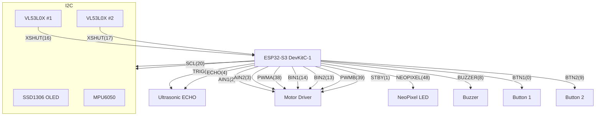

# Schematics & Wiring

This file documents the wiring used by the current firmware in `src/main.cpp`. Use this as a reference when building a schematic or PCB.

**GPIO to signal mapping** (matches `src/main.cpp` defines):

- **AIN1** : GPIO 2  — Motor driver A input 1
- **AIN2** : GPIO 3  — Motor driver A input 2
- **PWMA** : GPIO 38 — Motor A PWM (ledc)
- **BIN1** : GPIO 14 — Motor driver B input 1
- **BIN2** : GPIO 13 — Motor driver B input 2
- **PWMB** : GPIO 39 — Motor B PWM (ledc)
- **STBY** : GPIO 1  — Motor driver standby / enable
- **BUZZER_PIN** : GPIO 8 — Buzzer (PWM tone)
- **BTN1_PIN** : GPIO 0 — Button 1 (INPUT_PULLUP)
- **BTN2_PIN** : GPIO 9 — Button 2 (INPUT_PULLUP)
- **SDA_PIN** : GPIO 21 — I2C SDA (OLED, MPU6050)
- **SCL_PIN** : GPIO 20 — I2C SCL (OLED, MPU6050)
- **NEOPIXEL_PIN** : GPIO 48 — NeoPixel data in
- **ULTRASONIC_TRIG_PIN** : GPIO 19 — Ultrasonic TRIG
- **ULTRASONIC_ECHO_PIN** : GPIO 4  — Ultrasonic ECHO
- **XSHUT_PIN1** : GPIO 16 — VL53L0X #1 XSHUT (power/address control)
- **XSHUT_PIN2** : GPIO 17 — VL53L0X #2 XSHUT (power/address control)

VL53L0X default/assigned addresses in code:
- `LOX1_ADDR` = 0x30
- `LOX2_ADDR` = 0x31

Power notes:
- ESP32 board powered from USB 5V (onboard regulator supplies 3.3V logic).
- Motors should typically be powered from a separate battery (e.g., 7.4V or appropriate for motors) with common ground to the ESP32.
- VL53L0X and OLED modules are 3.3V/I2C friendly — power them from the ESP32's 3.3V rail.

Wiring table (component -> ESP32):

- OLED SSD1306 : VCC -> 3V3, GND -> GND, SDA -> `SDA_PIN` (21), SCL -> `SCL_PIN` (20)
- MPU6050 : VCC -> 3V3, GND -> GND, SDA -> `SDA_PIN` (21), SCL -> `SCL_PIN` (20)
- VL53L0X #1 : VIN -> 3V3, GND -> GND, SDA -> `SDA_PIN`, SCL -> `SCL_PIN`, XSHUT -> `XSHUT_PIN1` (16)
- VL53L0X #2 : VIN -> 3V3, GND -> GND, SDA -> `SDA_PIN`, SCL -> `SCL_PIN`, XSHUT -> `XSHUT_PIN2` (17)
- Ultrasonic : VCC -> 5V (or 3.3V depending on module), GND -> GND, TRIG -> `ULTRASONIC_TRIG_PIN` (19), ECHO -> `ULTRASONIC_ECHO_PIN` (4)
- Motor driver : Connect AIN1/AIN2/PWMA for motor A and BIN1/BIN2/PWMB for motor B; STBY -> `STBY` (1). Motor supply -> battery +, GND -> common GND.
- NeoPixel : 5V or 3.3V (depending on pixel spec) -> VCC, GND -> GND, DIN -> `NEOPIXEL_PIN` (48). If using 5V pixels with 3.3V MCU, add level-shifter on data line.
- Buzzer : + -> `BUZZER_PIN` (8), - -> GND
- Buttons : one side -> `BTN1_PIN`/`BTN2_PIN`, other side -> GND (internal pull-ups used)

Mermaid block for a high-level connection diagram:

How to create a proper schematic:

1. Use the wiring table above as the netlist for your schematic tool (Eagle, KiCad, or Fritzing).
2. Create separate power rails for logic (3.3V) and motors; show common ground.
3. Add decoupling capacitors on the motor supply and logic rails near devices.
4. For VL53L0X sensors, show the XSHUT pins wired to the two GPIOs so the code can readdress them at startup.

If you want, I can generate a KiCad schematic project skeleton (symbol placement + net names) or produce a Fritzing diagram image for breadboard-level wiring — tell me which format you prefer. 
